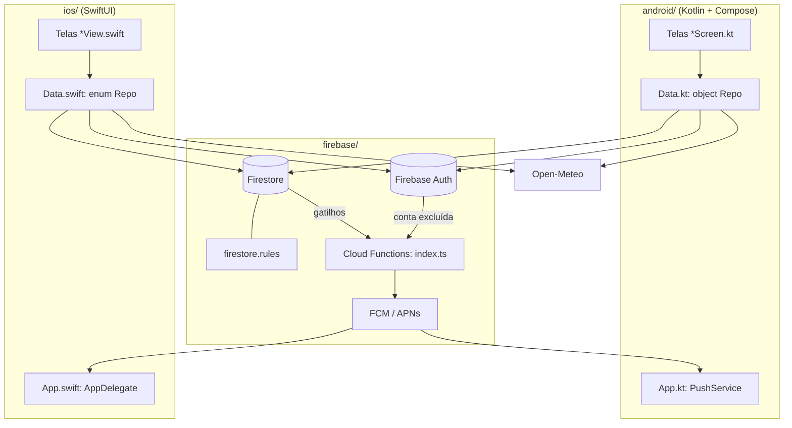
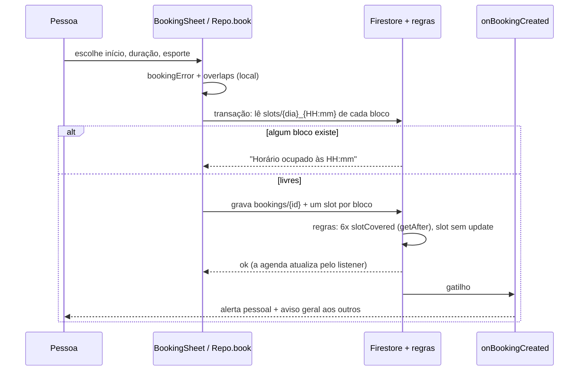
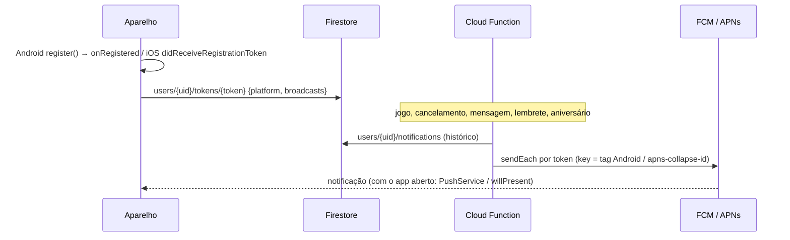

# Mapa do código

> Gerado pelo Cartographer. Último mapeamento: 2026-10-12T02:08:56Z

Apps da Quadra de Manaíra (quadra poliesportiva pública na orla de João Pessoa, PB): agenda de horários em
blocos de 30 min, mural com curtidas, conversa 1:1, alertas/push, perfil, clima e localização.
Dois apps nativos que se espelham arquivo por arquivo e um backend Firebase comum.

## Visão geral



## Estrutura

```
quadra-manaira-app/
├── LEIAME.md                       Como rodar, compilar, configurar o Firebase; decisões
├── docs/CODEBASE_MAP.md            Este mapa
├── android/                        Gradle 9.8.1, AGP 9.4.1 (Kotlin embutido), Kotlin 2.4.21
│   ├── build.gradle.kts            Versões dos plugins
│   └── app/
│       ├── build.gradle.kts        compileSdk 37, target 36, min 26; Compose BOM, Firebase BOM 35; override do Jackson
│       └── src/
│           ├── main/java/br/com/quadramanaira/   9 arquivos (abaixo)
│           ├── main/res/           Tema da janela, ícone adaptativo em vetor, fonte, foto de capa
│           ├── debug/AndroidManifest.xml          HTTP liberado só no debug (emulador)
│           └── test/.../LogicTest.kt              Testes das regras puras
├── ios/
│   ├── project.yml                 XcodeGen: iOS 17, Firebase iOS 13 via SwiftPM, ATS só rede local
│   ├── QuadraManaira/              8 arquivos .swift (espelho do Android), Assets, Fonts
│   └── QuadraManairaTests/         Testes das regras puras
└── firebase/
    ├── firebase.json               Regras, índices, Functions e emuladores (auth 9099, firestore 8080, UI 4000)
    ├── firestore.rules             Segurança: todo o negócio é revalidado aqui
    ├── firestore.indexes.json      2 índices compostos + collectionGroup de likes.uid
    └── functions/                  Node 22, ESM, TypeScript 7; override do @grpc/grpc-js
        ├── src/index.ts            Todas as Cloud Functions
        └── test/rules.test.mjs     8 cenários das regras no emulador
```

`../.github/workflows/ios.yml` (raiz do repositório) compila e testa o iOS num Mac do GitHub.

## Módulos

### Android (`android/app/src/main/java/br/com/quadramanaira/`)

**Ponto de entrada**: `App` (Application) → `MainActivity` → `Root()` ou `SetupScreen()`.

| Arquivo | Papel | Tokens |
|---|---|---|
| `Data.kt` | Modelos, `object Quadra` (horário, endereço), regras puras (`slots`, `bookingError`, `overlaps`, `birthError`, `ago`) e `object Repo` com todo o Firebase e o clima | ~7k |
| `App.kt` | Canal de notificação; **Firebase falso + emulador no debug sem config**; `PushService` (`onRegistered`, notificação com o app aberto) | ~0,9k |
| `MainActivity.kt` | Sessão (`AnimatedContent` por estado), abas com badges, rotas por cima (`chat:<uid>`, `local`) com `BackHandler`, tela de setup | ~2,1k |
| `Theme.kt` | Paleta clara/escura, fonte `Placar`, `Panel`, `ScreenTitle`, `Avatar`, `Chips`, `Empty`, `Loading` | ~1,7k |
| `AuthScreens.kt` | `Busy` + `CoroutineScope.act` (ação assíncrona com erro traduzido), login, cadastro, nova senha, completar perfil, `ProfileForm` | ~3,3k |
| `AgendaScreen.kt` | Faixa do clima, faixa de 14 dias, **linha do dia** (`DayTimeline`, `GrowingBlock`), `BookingSheet` | ~4,7k |
| `MuralScreen.kt` | Compositor que abre ao tocar, posts, curtir (pulso), apagar, denunciar, bloquear | ~2,6k |
| `ChatScreens.kt` | Lista de conversas + atletas; conversa com `reverseLayout`, marca como lida, denunciar/bloquear | ~2,9k |
| `OtherScreens.kt` | Alertas, Perfil (avisos gerais, sair, excluir conta), Localização (intent `geo:`) | ~3,1k |

**Depende de**: Firebase Auth/Firestore/Messaging, Credential Manager (Google), Open-Meteo.
**Sem**: ViewModels, navigation-compose, injeção de dependência. As telas coletam os `Flow` do `Repo` com
`remember { ... }.collectAsStateWithLifecycle()`.

### iOS (`ios/QuadraManaira/`)

**Ponto de entrada**: `@main QuadraApp` + `AppDelegate` → `RootView` ou `SetupView`.

| Android | iOS | Diferença |
|---|---|---|
| `Data.kt` (`Flow`) | `Data.swift` (`AsyncStream`; cancelar a task remove o listener) | Dia como string `yyyy-MM-dd` em vez de `LocalDate` |
| `App.kt` | `App.swift` | Push: `MessagingDelegate` + `willPresent`; pede permissão depois do login |
| `MainActivity.kt` | `App.swift` (`RootView`) + `HomeView` em `AgendaView.swift` | `TabView` com `NavigationStack` por aba |
| `Theme.kt` | `Theme.swift` | `Busy` é `@Observable`; `BigButton` |
| `AuthScreens.kt` | `AuthViews.swift` | **Sem login com Google** (App Store exigiria "Entrar com a Apple") |
| `AgendaScreen.kt` | `AgendaView.swift` | `Canvas` para as linhas; `fitsSlot` público e testado |
| `MuralScreen.kt` | `MuralView.swift` | Pulso da curtida com `.symbolEffect(.bounce)` |
| `ChatScreens.kt` | `ChatViews.swift` | `.defaultScrollAnchor(.bottom)` no lugar do `reverseLayout` |
| `OtherScreens.kt` | `OtherViews.swift` | `ShareLink` e Apple Maps |
| `LogicTest.kt` | `LogicTests.swift` | iOS testa também `formatBirth` e `fitsSlot` |

### Firebase (`firebase/`)

**Regras** (`firestore.rules`): o app nunca é confiável.

| Coleção | Quem escreve | Regra principal |
|---|---|---|
| `users/{uid}` | o dono | campos fixos; nome 2–60; avatar entre 5 emojis |
| `users/{uid}/private/data` | o dono | só o dono lê; e-mail igual ao do login; até 500 bloqueados |
| `users/{uid}/tokens/{token}` | o dono | `platform` android/ios, `broadcasts` bool |
| `users/{uid}/notifications/{id}` | só Functions | o dono só muda `read` |
| `bookings/{id}` | o organizador | nome = nome do perfil; até 3 h; **os 6 blocos têm de existir no fim da escrita** (`getAfter`); só cancela |
| `slots/{data}_{HH:mm}` | o organizador | **update proibido = sem conflito de horário**; tem de cair dentro de um jogo dele |
| `posts/{id}` (+ `likes/{uid}`) | o autor | só `likesCount ±1` junto com a própria curtida |
| `conversations/{a_b}` (+ `messages`) | participantes | nomes verdadeiros; meu não lido só zera, o do outro só sobe 1; bloqueio barra a mensagem |
| `reports/{id}` | qualquer logado | ninguém lê (só o console) |

**Functions** (`functions/src/index.ts`, região `southamerica-east1`):

| Função | Gatilho | Faz |
|---|---|---|
| `onBookingCreated` | jogo criado | alerta ao organizador + aviso geral |
| `onBookingUpdated` | jogo cancelado | aviso "Horário liberado" (mesma `key`, substitui o anterior) |
| `onMessageCreated` | mensagem criada | alerta + push a quem recebeu |
| `bookingReminders` | a cada 15 min | lembrete 24 h antes; sempre marca `reminderSent` |
| `birthdays` | 08:00 | parabéns + aviso geral |
| `onPostDeleted` | post apagado | apaga curtidas órfãs |
| `monthlyCleanup` | dia 1º, 04:00 | apaga jogos e blocos passados |
| `onUserDeleted` | conta excluída (gatilho v1) | apaga posts, curtidas, conversas, perfil; cancela jogos futuros |

`notifyUser` grava o histórico e manda push para os aparelhos da pessoa. `notifyAll` manda para todos os
tokens com `broadcasts != false`, menos quem causou o evento. Tokens mortos são apagados.

## Fluxos

### Agendar (sem conflito entre dois aparelhos)



### Sessão

```mermaid
sequenceDiagram
    participant App
    participant Auth as Firebase Auth
    participant FS as Firestore
    App->>Auth: IdTokenListener (muda também quando o e-mail é confirmado)
    alt sem usuário
        App->>App: SignedOut → login/cadastro
    else e-mail não confirmado
        App->>App: Unverified → "Confirme seu e-mail" (confere ao voltar para o app)
    else com usuário confirmado
        App->>FS: escuta users/{uid} + users/{uid}/private/data
        alt sem perfil ou sem nascimento
            App->>App: NeedsProfile → "Falta pouco"
        else completo
            App->>App: Ready(me) → abas; registerDevice()
        end
    end
```

### Push



## Convenções

- Os dois apps têm os **mesmos nomes** de arquivos, funções do `Repo` e campos do Firestore. Mudou um, mude o outro.
- Regras puras ficam no topo de `Data.*` e têm teste nos dois sistemas.
- Erros para a tela: `UserError` com texto pronto; `friendly()` traduz exceções do Firebase.
- Ações assíncronas da UI passam por `Busy` (`act` no Android, `run` no iOS): bloqueia toque duplo e guarda o erro.
- Texto da interface em português, voz ativa, sem caixa alta em rótulos; títulos e números na fonte `Placar`.
- Escritas de vários documentos: `batch` (perfil, curtida, conversa, cancelamento) ou transação (agendar).
- Simplificações conscientes levam um comentário `ponytail:` com o limite e o caminho de troca.

## Pegadinhas

- **Debug sem config usa o emulador** (`demo-quadra`; Android em `10.0.2.2`, iOS em `localhost`). Release sem config abre a tela de setup e não conecta em nada.
- **Teto de 3 h em três lugares**: `MAX_MINUTES` (apps), os 6 `slotCovered` e o `<= 180` das regras. Subir o teto exige mexer nas regras.
- **Ids de conversa** são `uidA_uidB` ordenados; as regras tiram os participantes do id.
- **Nas regras, `$(caminho)` com barras vira um segmento só.** Monte caminhos literais (`/users/$(uid)/private/data`).
- **FCM 26**: `getToken()`/`onNewToken` estão obsoletos; o token chega em `onRegistered` depois de `register()`.
- **Overrides de segurança**: Jackson 2.21.7 (Android) e `@grpc/grpc-js` ^1.14.6 (Functions). Tirar quando o Firebase atualizar.
- **iOS**: `aps-environment` está como `development` no `project.yml` (o Xcode troca pelo valor do perfil de distribuição ao exportar); push só funciona com a chave APNs no console.
- **Git Bash nesta máquina**: tirar a aspa solta do `PATH` antes do Gradle, senão os testes unitários quebram.
- Um remetente bloqueado só descobre pelo erro de permissão ao enviar (ele não lê a lista de bloqueio do outro).

## Onde mexer

| Tarefa | Arquivos |
|---|---|
| Mudar horário de funcionamento ou duração máxima | `Data.kt` e `Data.swift` (`Quadra`), `firestore.rules` (`validTime`, `slotCovered`, `<= 180`), testes |
| Novo campo no perfil | `Data.*` (`Profile`, `writeProfile`, `toProfile`/`profile`), `ProfileForm` nos dois apps, regra de `users/{uid}`, teste das regras |
| Novo tipo de alerta | `index.ts` (`Kind`, chamada a `notifyUser`/`notifyAll`), ícone em `OtherScreens.kt`/`OtherViews.swift` |
| Mudar textos ou cores | `Theme.kt`/`Theme.swift`; textos ficam nas próprias telas |
| Regras de segurança | `firestore.rules` + `functions/test/rules.test.mjs` (`npm run test:rules`) |
| Push | `index.ts` (`message`, `send`), `App.kt` (`PushService`), `App.swift` (`AppDelegate`) |
| Dependências | `android/app/build.gradle.kts`, `ios/project.yml`, `firebase/functions/package.json`; depois `npm audit` e uma consulta ao OSV |
